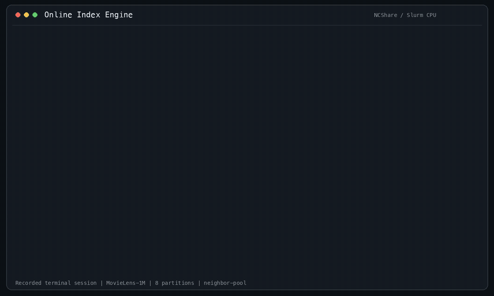
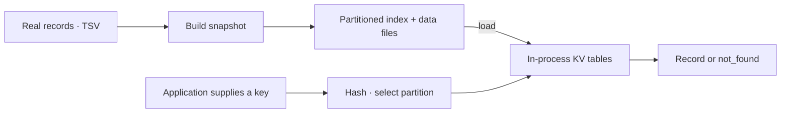
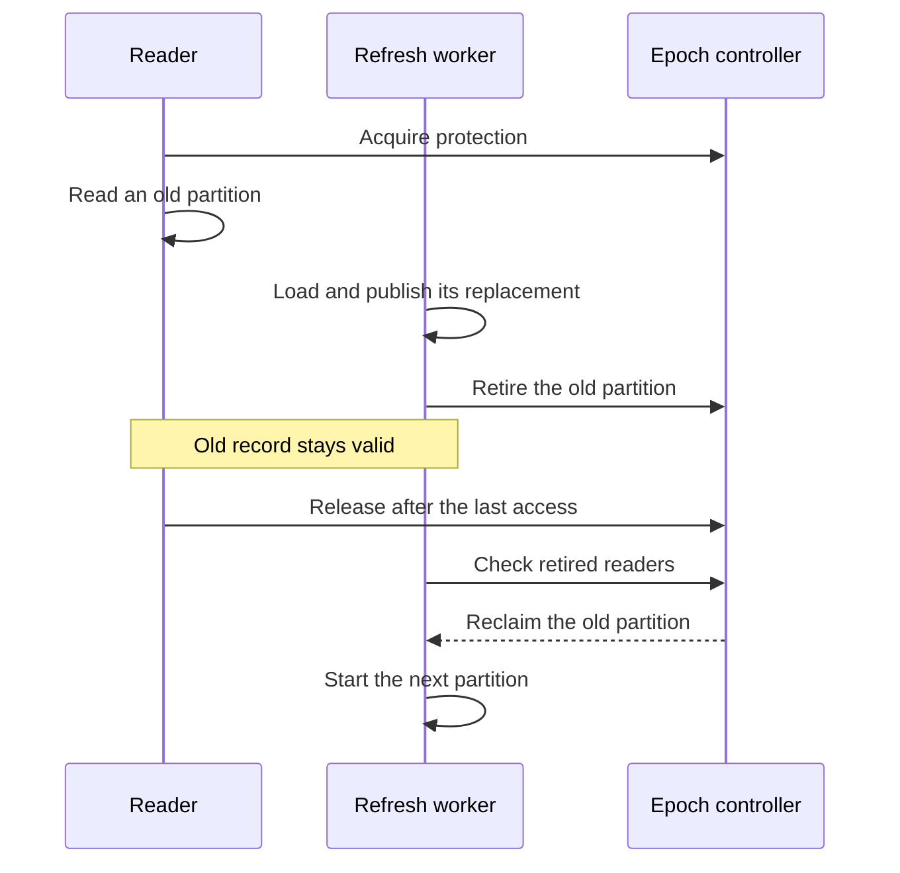
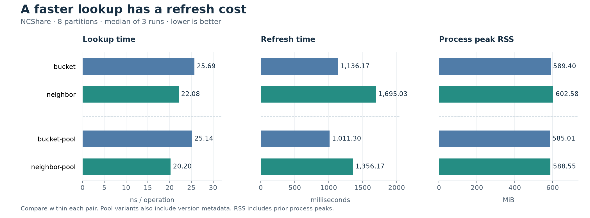

# Online Index Engine

**Keep records ready to query. Refresh them one partition at a time.**

[](https://github.com/Zhang-Xin-Duke/online-index-engine-public/actions/workflows/build.yml)

A C++17 in-process **key → record** engine. Load a snapshot into memory, look up an ID, and publish new partitions while existing readers finish safely. Two hash layouts organize the lookup path; a chunk allocator manages record storage; epoch protection controls when old data can be reclaimed.

Think of an application asking: **“What record belongs to this ID?”** The engine returns the record or `not_found`. Applications decide how to use the result. Data arrives through snapshots; lookup misses return directly, without automatic database fetches or cache admission.

[Watch the demo](#demo-on-ncshare) · [Follow one record](#follow-one-record) · [See the results](#measured-results) · [Build and run](#build-and-run)

## Demo on NCShare

[](assets/demo/ncshare-demo.mp4?raw=1)

**58 seconds: build → query → miss → refresh → query.** [Download the MP4](assets/demo/ncshare-demo.mp4?raw=1).

This scripted terminal session was captured inside a real NCShare Slurm allocation: **4 CPU cores, no GPU, 8 partitions, `neighbor-pool`**. The executable was compiled on the cluster before recording. It processes real MovieLens-1M rating events.

## Follow one record

In the demo, key **`800168`** is a chronological event ID. Its value describes a real rating of *Xiu Xiu: The Sent-Down Girl (1998)*: movie ID `2621`, rating `4`.

| When the application asks for `800168` | What the engine returns |
|---|---|
| Old snapshot: 800,168 events | `found: false` |
| After refreshing to 1,000,209 events | `found: true`, `generation: 2`, the rating record |

Movie IDs are fields inside the value. The lookup key identifies the rating event, so a movie with many ratings can appear in many records.



The file index stores **key + offset** entries. Loading follows those offsets and constructs owned runtime records, including their strings. A query selects a partition, searches its table, and borrows the matching record under reader protection.

## Why refresh one partition at a time?

During a whole-table replacement, the old table may still serve readers while a complete new table is being built. Partitioned refresh shrinks that overlap to one partition at a time:

**Build the new partition → publish its pointer → wait for old readers → reclaim the old partition → advance.**



For a stable table of size **M**, split into **N similarly sized partitions**, the ideal live-table model is **M + M/N**. With 8 equal partitions, that is about **1.125 × M**, before temporary buffers, strings, metadata, and allocator retention. This is a model of live table storage; measured process RSS includes additional costs.

A slow reader can delay reclamation and therefore the next partition's refresh. On MovieLens-1M, both serial builders reached about 487 MiB of process RSS. Building the entire replacement in parallel raised the peak to 656 MiB. [See the refresh comparison](#refresh-peak-memory-and-time).

## Four ways to store the same records

| Backend | How lookup finds a record | How records are allocated |
|---|---|---|
| `bucket` | Locate a bucket, then scan its contiguous key/pointer nodes | Individual allocations |
| `neighbor` | Compare compact bucket nodes; follow relative collision links | Individual allocations |
| `bucket-pool` | Bucket directory + contiguous nodes | Chunk-allocated versioned records |
| `neighbor-pool` | Compact buckets + relative links | Chunk-allocated versioned records |

A compact node fits a **64-bit key + 16-bit relative link + 48-bit pointer into 16 bytes**. Supported pointer addresses must fit that field; out-of-range values are rejected. Bucket capacity and collision layout affect both space and construction cost.

Compare layouts **within a row pair**: `bucket` ↔ `neighbor`, or `bucket-pool` ↔ `neighbor-pool`. Crossing pairs changes both allocation strategy and version metadata.

## Measured results

### Refresh peak memory and time

**With one partition builder in each strategy, N+1 showed no consistent peak RSS saving over whole-table double buffering.** Its median peak was **0.86 MiB higher** and its median refresh took **45.7 ms longer**. Against a whole-table double buffer that built all eight partitions in parallel, N+1 used **168.87 MiB less peak RSS (25.7%)** and took **420.0 ms longer (2.21× the refresh time)**.

| Refresh strategy | When readers can see new data | Peak process RSS, MiB | Refresh time, ms |
|---|---|---:|---:|
| N+1, serial build | Each partition as it is ready | **487.37** (486.42–489.70) | **766.8** (706.0–831.1) |
| Whole-table double buffer, serial build | One swap after all eight are ready | **486.51** (485.81–488.58) | **721.1** (710.7–837.4) |
| Whole-table double buffer, parallel build | One swap after all eight are ready | **656.24** (655.95–656.30) | **346.8** (341.2–350.3) |

Each cell gives the median of six runs, with the minimum and maximum in parentheses. Both serial strategies loaded one new partition at a time. N+1 reclaimed the corresponding old partition before proceeding. The serial double buffer kept the entire old generation through the final swap. N+1 bounds the number of live partitions, but freed memory can remain resident in the process. The parallel comparison also changes the number of concurrent builders, so the 25.7% difference cannot be attributed to earlier reclamation alone.

<details>
<summary><strong>How the comparison was measured</strong></summary>

- **Inputs and workload.** All runs used the same two MovieLens-1M snapshots (800,168 → 1,000,209 real rating events), eight partitions and the `neighbor-pool` backend. Four reader threads queried existing keys under epoch protection, each targeting one lookup per millisecond.
- **Run order and hardware.** One NCShare Slurm allocation on an Intel Xeon Platinum 8568Y+ host, eight CPUs and 16 GiB of RAM, CPU only. Six blocks covered all six possible orders of the three strategies. Each invocation started in a fresh process and loaded the old table the same way. [Runtime revision](https://github.com/Zhang-Xin-Duke/online-index-engine-public/tree/e28bc8fba91652807a476df44a622fe61d3b43a1).
- **Measurement window.** After loading the old table and warming the readers, the harness reset the Linux process RSS high-water mark. Starting RSS was about 222 MiB in all three modes. Peak is the process `VmHWM` read after refresh. Wall time runs from the start of loading the replacement through publication, waiting for readers, and reclaiming the old data. Snapshot construction and the subsequent full-record check are outside the window.
- **Correctness.** Across 18 runs, concurrent readers reported zero invalid IDs or generations. After each refresh, every one of the 1,000,209 records matched the new input by ID, generation and value.

</details>

### Does refresh preserve the records?

The public runtime was validated locally against every record in two real snapshots, with four reader threads active during refresh.

| Check | Observed result |
|---|---|
| Full-record checks, each of four backends | 800,168 old + 1,000,209 new records matched |
| Concurrent refresh, each backend | 0 reader errors |
| Core cases: empty tables, zero keys, held readers, pool reuse/alignment, failure handling | 10 tests passed |
| CLI cases: hit, miss, refresh, JSON output and invalid input | 47 checks passed |
| AddressSanitizer + UndefinedBehaviorSanitizer | The same 10 tests and 47 CLI checks passed on macOS |
| Independent build | [Linux CI passed](https://github.com/Zhang-Xin-Duke/online-index-engine-public/actions/runs/43532105260); anonymous clone and build also checked |

The sanitizer run used `detect_leaks=0`. The checks cover the exercised paths and interleavings. Test code, raw data and logs remain outside this public repository; these tables publish the results.

### Faster lookup comes with a refresh tradeoff

The following **NCShare reference measurements** used a separate harness over these table backends before the public CLI was packaged. The median of three runs at **8 partitions** is shown below. These are backend measurements; each invocation of the public CLI has its own loading and output costs.



| Backend | Lookup ns/op ↓ | Refresh ms ↓ | Process peak RSS MiB ↓ |
|---|---:|---:|---:|
| `bucket` | 25.69 | 1136.17 | 589.40 |
| `neighbor` | 22.08 | 1695.03 | 602.58 |
| `bucket-pool` | 25.14 | 1011.30 | 585.01 |
| `neighbor-pool` | 20.20 | 1356.17 | 588.55 |

- **Individual-allocation pair:** neighbor lookup time decreased **14.1%**; refresh time increased **49.2%** and peak RSS increased **2.2%**.
- **Pool/versioned-record pair:** neighbor lookup time decreased **19.7%**; refresh time increased **34.1%** and peak RSS increased **0.6%**.

The useful decision is workload-dependent: how much lookup latency matters relative to refresh duration and memory headroom. These measurements support a lookup improvement under the tested conditions, with a higher refresh cost.

<details>
<summary><strong>Measurement conditions and boundaries</strong></summary>

- **Machine:** shared NCShare host, Intel Xeon Platinum 8568Y+, Ubuntu 22.04 / GCC 11.4; Slurm allocation of 8 CPU cores and 16 GiB RAM, no GPU. This is separate from the 4-CPU demo allocation.
- **Input:** real MovieLens-1M rating events; old snapshot 800,168 records, new snapshot 1,000,209. Generation labels distinguish snapshots. Events are ordered chronologically; the cutoff retains timestamp ties.
- **Matrix:** 4/8/16 partitions × 4 backends × 3 runs = 36 completed runs. Every run checked all 1,000,209 new records, with zero errors.
- **Lookup:** old-snapshot keys shuffled with a fixed seed; 100% hits; one warm-up pass and five timed passes. Timing includes hashing, partition selection, lookup, validation and checksum accumulation. One epoch handle covers the timed batch; there is no network/RPC timing.
- **Refresh:** sequential N+1 refresh with four concurrent reader threads. The table construction threshold is `0.9`; power-of-two capacity rounding determines actual occupancy.
- **Memory:** this backend matrix records the process high-water mark including initial loading. The [refresh strategy comparison](#refresh-peak-memory-and-time) above resets the high-water mark after initial loading to isolate the refresh window.
- **Interpretation:** three repetitions provide a reference comparison on shared hardware. The run does not establish a production SLA or tail latency. Cross-pair comparisons do not isolate allocator effects.

</details>

<details>
<summary><strong>Real data: source and snapshot contents</strong></summary>

Source: [GroupLens MovieLens-1M](https://grouplens.org/datasets/movielens/1m/) · [Dataset documentation](https://files.grouplens.org/datasets/movielens/ml-1m-README.txt).

| Snapshot | Records | Generation | Meaning |
|---|---:|---:|---|
| Old | 800,168 | 1 | Approximately the first 80% of chronological events |
| New | 1,000,209 | 2 | All events |

Keys are chronological event IDs. Values retain the real user ID, movie ID, rating, timestamp, title and genres. Snapshot construction uses these records without generated payloads or replicated rows. Query order is controlled by the harness; the input records are real, while the workload is a defined microbenchmark rather than a production traffic trace.

Archive SHA-256:

```text
a6898adb50b9ca05aa231689da44c217cb524e7ebd39d264c56e2832f2c54e20
```

</details>

## Build and run


Requires a C++17 compiler, CMake 3.20 or later, and a POSIX environment. Linux and macOS are supported. Public dependencies are downloaded during configuration: Abseil, Protobuf, and FlatBuffers. CMake 3.31.6 is used by the Linux build workflow.

```bash
git clone https://github.com/Zhang-Xin-Duke/online-index-engine-public.git
cd online-index-engine-public
cmake -S . -B build -DCMAKE_BUILD_TYPE=Release
cmake --build build --parallel 2
```

To use installed Protobuf and Abseil packages, configure with `-DENGINE_BUNDLED_DEPS=OFF`. FlatBuffers remains a pinned build dependency. `-DENGINE_SANITIZE=ON` enables address and undefined-behavior instrumentation on compilers that support it.

With input TSV files available, the same three operations used in the demo are:

```bash
build/online_index build g1.tsv snapshot-v1 8
build/online_index build g2.tsv snapshot-v2 8
build/online_index query neighbor-pool snapshot-v1 0
build/online_index refresh neighbor-pool snapshot-v1 snapshot-v2 800168
```

<details>
<summary><strong>Input format, command reference and exit codes</strong></summary>


Input is a UTF-8 TSV file without a header. Each row contains three fields:

```text
id<TAB>generation<TAB>value
```

`id` and `generation` are unsigned 64-bit decimal integers. IDs must be unique in a snapshot. The value may be empty, but cannot contain literal tabs or newlines. Additional columns, if present, are ignored. An empty file represents an empty snapshot.

```bash
build/online_index build records.tsv snapshot-v1 8
build/online_index query neighbor snapshot-v1 1001
build/online_index refresh neighbor snapshot-v1 snapshot-v2 1001
```

- `build INPUT_TSV OUTPUT_DIR SHARDS` creates a snapshot. The output directory must not already exist. `SHARDS` must be a power of two from 1 through 1024.
- `query BACKEND SNAPSHOT_DIR KEY` loads a snapshot and prints the matching record as JSON. A miss prints `"found":false` and `"status":"not_found"`.
- `refresh BACKEND OLD_DIR NEW_DIR KEY` loads the old snapshot, prints the selected record with `"phase":"before"`, refreshes the table, and prints the record with `"phase":"after"`. Both snapshots must have the same partition count. This command runs in one process and does not change the source snapshot directories or a running external service.

Successful operations, including lookup misses, exit with status 0. Invalid command syntax exits with status 2; invalid input, unsupported backends, and load/refresh failures exit with status 1 and an error on stderr. Each JSON result is written on its own stdout line. `--help` lists the commands.

</details>

## Embed the engine

Start with [the record adapter and backend aliases](src/engine.h), then [the CLI's guarded queries](src/main.cc). The table, allocator and refresh implementations live under [core/index_engine](core/index_engine).

`ShardedReloadable<T>` exposes `Load`, `GetShard`, `ResetDir` and `Reload`. Acquire an epoch handle **before** retrieving a partition pointer; release it **after** the final record access. The controller must outlive the table and its readers. Initial loading can construct partitions concurrently; refresh has one writer.

| Situation | Behavior to design around |
|---|---|
| A reader holds an old record | Reclamation waits; refresh progress may stall |
| One request reads several partitions during refresh | It may observe mixed snapshot generations |
| A later partition fails to load | Earlier replacements may remain visible; no automatic whole-refresh rollback |
| A key is absent | The caller receives `not_found` and chooses the next action |

Snapshot files must come from a trusted producer. Metadata and size checks are provided; complete validation of arbitrary untrusted binary files is outside this module. Streaming ingestion, distributed replica coordination and service-level rollback belong to the integrating application.
